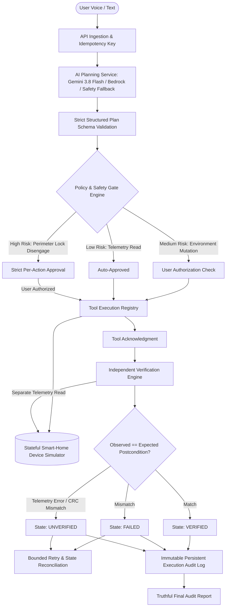
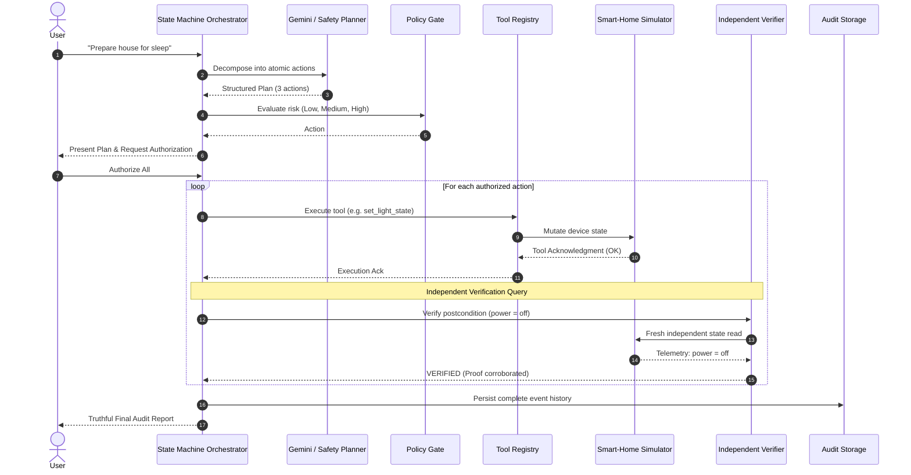

# ActionGuard AI

> **"An AI assistant that proves what it did."**

ActionGuard AI is a reliable AI agent orchestration and verified task execution platform for smart-home automation. Unlike conventional conversational AI assistants that claim success merely because a model intended or requested an operation, ActionGuard AI enforces a foundational principle:

> **"Never claim an action succeeded merely because the AI intended it to succeed."**

---

## 🏆 Hackathon Target Tracks

- **Primary Target:** Amazon Developer Hackathon 2026 — Alexa+ Primary Track (via the explicitly permitted simulated Alexa+ experience route).
- **Secondary Target:** AWS Builder Mini Challenge — Amazon Bedrock runtime planning adapter with structured output validation and clear credential detection.
- **Open-Source Objective:** Clean decoupled architecture with standalone reusable verification engine ready for upstream contribution.

---

## 💡 The Core Problem

Most AI smart-home assistants operate on a fire-and-forget basis:
1. User: *"Set bedroom temperature to 22° and lock the front door."*
2. Assistant: *"I've set the temperature to 22 degrees and locked the door."*

**The Reality:** The thermostat actuator timed out, the deadbolt jammed on an obstruction, or the command was dropped by a mesh gateway. The assistant lied because it equated **intent** with **physical completion**.

ActionGuard AI eliminates this failure mode by maintaining a strict distinction between:
1. **What the user requested.**
2. **What the AI planned.**
3. **What the user authorized (policy & permission gates).**
4. **What the tool attempted.**
5. **What the tool returned.**
6. **What an independent post-action read verified.**
7. **What remains failed, uncertain, or unverified.**

---

## 🏛️ System Architecture



---

## 🔄 Execution & Verification Sequence



---

## 🚀 Key Features

### 1. Controlled State Machine Orchestration
Transitions through explicit phases:
`IDLE` → `PLANNING` → `PLAN_READY` → `AWAITING_APPROVAL` → `EXECUTING` → `VERIFYING` → `COMPLETED` / `PARTIALLY_COMPLETED` / `FAILED` / `UNVERIFIED`

### 2. Stateful Smart-Home Simulator (Zero Hardware Dependency)
Includes 5 virtual devices with real-time state:
- **Living Room Lights** (`living_room_lights`): On/off, brightness 0-100%.
- **Bedroom Lights** (`bedroom_lights`): On/off, brightness 0-100%.
- **Bedroom Thermostat** (`bedroom_thermostat`): Temperature range 16–30°C.
- **Front-Door Lock** (`front_door_lock`): Deadbolt state. Unlocking is strictly high-risk.
- **Night Mode Controller** (`night_mode`): Whole-home security routine.

### 3. Interactive Failure Injection Lab
Deterministic failure toggles for hackathon demonstrations:
- **Thermostat Write Failure:** Hardware actuator timeout on write.
- **Verification Read Failure:** Sensor CRC mismatch. Demonstrates the **UNVERIFIED** state.
- **Simulated Hardware Latency:** Progress indicators and timeout handling.
- **Device Disconnection:** Force any simulated device offline.
- **Partial Completion Mode:** One action succeeds while another fails.

### 4. Policy & Approval Engine
- **Low Risk:** Device telemetry reads execute autonomously.
- **Medium Risk:** Light and thermostat changes require approval based on user profile.
- **High Risk:** Disengaging entrance deadbolts strictly requires explicit confirmation. Approvals bind cryptographically to the exact action parameters.

### 5. Multi-Provider AI Planning
- **Google Gemini 3.8 Flash:** Server-side structured output with Zod schema validation.
- **Amazon Bedrock:** AWS Builder Challenge adapter with credential detection and live connection tests.
- **Deterministic Safety Fallback:** Ensures 100% demo reliability even without external API keys or offline.

---

## 🎬 3-Minute Demo Video Script (2m 45s)

| Timestamp | Screen | Narrative / Action |
| :--- | :--- | :--- |
| **0:00 – 0:20** | Overview Dashboard | *"Most AI assistants generate a convincing response, but cannot prove what actually happened in the physical world. ActionGuard AI solves this: never claim an action succeeded merely because the AI intended it to."* |
| **0:20 – 0:50** | Command Centre | Enter: *"Prepare my house for sleep."* Show the AI generate a 3-step structured plan with postconditions. Point out the policy gate: light and temperature operations require approval. Click **Authorize All**. |
| **0:50 – 1:30** | Failure Lab | Open the Failure Lab and toggle **Thermostat Write Failure**. Click **Execute Verified Plan**. Watch the live timeline: lights turn off and verify; thermostat times out. Show the honest final report: **Partially Completed** with exact failure reasoning. |
| **1:30 – 2:05** | Recovery & Verification | Turn off the failure injection in the lab and click **Retry Action**. The retry executes, the independent read queries the physical setpoint, and the state flips to **VERIFIED (22°C)**. |
| **2:05 – 2:30** | Safety Boundary | Run: *"Unlock the front door."* Demonstrate the **High-Risk Perimeter Safety Gate** refusing blanket execution without explicit confirmation. |
| **2:30 – 2:45** | Integrations & Audit | Show the AWS Bedrock integration status, the complete audit log with JSON/CSV export, and the MCP-ready architecture. |

---

## 🛠️ Technology Stack

- **Frontend:** React 19, TypeScript, Vite, Tailwind CSS, Lucide Icons, Motion.
- **Backend:** Node.js, Express, TypeScript (`tsx`).
- **AI Models:** Google Gemini 3.8 Flash (`@google/genai`), Amazon Bedrock Claude/Nova adapter.
- **Validation:** Zod schemas.
- **Testing:** Vitest test runner.
- **Storage:** Durable server-side JSON storage with in-memory cache and atomic disk persistence.

---

## 💻 Setup & Installation

### Prerequisites
- Node.js >= 20
- npm >= 10

### 1. Clone & Install
```bash
git clone https://github.com/example/actionguard-ai.git
cd actionguard-ai
npm install
```

### 2. Environment Variables
Create a `.env` file based on `.env.example`:
```env
PORT=3000
NODE_ENV=development
DEMO_MODE=true
AI_PROVIDER=gemini

# Optional: Google Gemini API Key (automatically injected in AI Studio)
GEMINI_API_KEY="your-gemini-key"

# Optional: Amazon Bedrock (for AWS Builder Challenge)
AWS_REGION=us-east-1
BEDROCK_MODEL_ID=anthropic.claude-3-haiku-20240307-v1:0
AWS_ACCESS_KEY_ID=
AWS_SECRET_ACCESS_KEY=
```

### 3. Run Development Server
```bash
npm run dev
```
Open [http://localhost:3000](http://localhost:3000) in your browser.

### 4. Run Automated Test Suite
```bash
npm test
```

---

## 🔒 Security & Privacy

1. **Zero Client Secrets:** All Gemini and AWS Bedrock keys reside exclusively on the server.
2. **Strict Tool Whitelist:** The AI model cannot execute arbitrary shell scripts, URLs, or unknown functions.
3. **Approval Tamper Resistance:** Approvals are bound strictly to plan IDs and exact action arguments.
4. **Idempotency Safeguards:** Duplicate submissions with matching keys do not repeat completed physical mutations.
5. **No Hallucinated Verification:** Telemetry proofs originate solely from independent simulator reads.

---

## 📄 License

Licensed under the [Apache License, Version 2.0](LICENSE).
